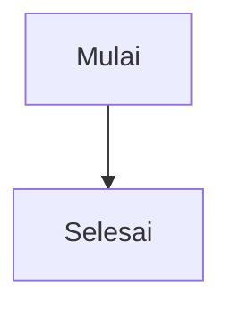

# Kriteria penerimaan dan fixture `reamd`

Dokumen ini menjelaskan cara menentukan apakah MVP `reamd` memenuhi perilaku yang disepakati. Fixture adalah contoh dokumen input untuk memeriksa hasil parser dan tampilan. Fixture di bawah ditulis di dokumen ini dahulu; file fixture terpisah dan implementasi test akan dibuat saat pekerjaan coding dimulai.

Terkait: [spesifikasi command](command-spec.md) dan [analisis teknis](markdown-terminal-reader-analysis.md).

## Status dan prinsip verifikasi

- Ini adalah target penerimaan, bukan bukti bahwa fitur sudah dibuat atau lulus test.
- Dokumentasi ini menggunakan Bahasa Indonesia. Bantuan dan pesan error aplikasi menggunakan Bahasa Inggris.
- Nilai hasil fixture dinilai dari makna dan perilaku yang terlihat, bukan kecocokan byte-per-byte terhadap warna ANSI atau screenshot.
- Parser harus mendukung seluruh sintaks CommonMark dan GFM. Renderer harus menampilkan elemen tersebut atau memakai fallback aman yang tidak menghilangkan isi secara diam-diam.
- Test otomatis dipakai untuk parsing, layout, input file, keamanan, dan kode keluar pada Windows, macOS, dan Linux.
- Smoke test manual dipakai untuk TUI nyata, mouse, clipboard, dan membuka browser pada terminal perwakilan: Windows Terminal, Terminal.app, serta GNOME Terminal atau emulator Linux yang kompatibel.
- Fungsi utama tetap tersedia lewat keyboard meski terminal tidak melaporkan dukungan mouse.

## Kriteria penerimaan

### AC-CLI: command dan file

- `reamd <path>` membaca satu file sebagai Markdown tanpa bergantung pada ekstensi nama file.
- `reamd` tanpa argumen menampilkan bantuan dan contoh penggunaan dalam Bahasa Inggris, lalu keluar dengan kode `0`.
- `reamd --help` dan `reamd --version` tidak membuka TUI dan keluar dengan kode `0`.
- Path berisi spasi dan karakter Unicode dapat dibuka bila file dapat dibaca.
- Banyak path, opsi tema yang tidak dikenal, atau argumen yang tidak valid menghasilkan pesan penggunaan dalam Bahasa Inggris dan kode `2`.
- File tidak ditemukan, tidak dapat dibaca, bukan UTF-8 yang dapat diproses, atau terdeteksi sebagai file biner menghasilkan pesan error yang menjelaskan masalah dan kode `1`.
- Error sebelum TUI dimulai tidak meninggalkan terminal dalam mode interaktif.
- Input stdin tidak didukung pada MVP.

### AC-MD: CommonMark dan GFM

- Parser mengenali seluruh sintaks CommonMark dan GFM, termasuk elemen blok, inline, list bertingkat, link referensi, tabel, task list, dan strikethrough. Linkify juga mengenali URL HTTP(S) serta alamat email polos sebagai autolink untuk ditampilkan.
- Penambahan Linkify di atas profil GFM spec 0.29 adalah perilaku produk yang disengaja. Link email atau protokol selain HTTP(S) tidak membuka aplikasi eksternal; link web hanya dibuka setelah aktivasi eksplisit.
- Setiap jenis elemen yang dikenali dirender atau memiliki fallback aman yang tetap menyampaikan isi. Tidak ada isi yang hilang diam-diam.
- Kumpulan conformance test yang sesuai dengan versi spesifikasi/parser yang dipilih harus dijalankan saat library ditetapkan. Versi parser dan profil kesesuaian dicatat dalam test setup.
- Raw HTML tidak dieksekusi. Tag dan teksnya ditampilkan sebagai teks yang aman.
- Mermaid ditandai sebagai diagram dan source-nya ditampilkan; MVP tidak perlu menggambar diagram.

### AC-TUI: navigasi, resize, dan zoom

- Di terminal interaktif, file terbuka sebagai pembaca read-only dalam terminal yang sama. Isi file tidak berubah setelah sesi ditutup.
- Panah dan `j`/`k` menggulir satu baris; `PageUp`/`PageDown` menggulir kira-kira satu layar; `Home`/`End` menuju awal/akhir.
- `q` dan `Esc` menutup TUI. Terminal kembali ke mode normal setelah keluar normal maupun setelah error atau interupsi.
- `?` menampilkan dan menutup panel bantuan pintasan.
- Perubahan ukuran terminal saat dokumen terbuka langsung menata ulang konten.
- TUI dapat beroperasi dengan ukuran 40 kolom × 10 baris atau lebih. Di bawah ukuran itu, tampilkan pesan singkat agar terminal diperbesar dan cara keluar tetap tersedia.
- Zoom dimulai dari 100%, berubah 10 poin per langkah, dibatasi 70%-150%, dan tombol `0` tanpa modifier mengembalikan 100%.
- `=` memperbesar tanpa memerlukan Shift, `+` tetap menjadi alias, dan `-` memperkecil. `Ctrl+Plus`/`Ctrl+-` dapat menjadi alternatif jika terminal meneruskan kombinasi tersebut. Zoom mengubah kepadatan dan wrapping layout, bukan ukuran font emulator terminal.

### AC-MOUSE: mouse, link, seleksi, dan clipboard

- Scroll wheel menggulir dokumen pada terminal yang melaporkan dukungan mouse.
- Klik track scrollbar memindahkan posisi dokumen; drag thumb menggulir secara langsung.
- Drag memilih teks yang terlihat. `Ctrl+C` menyalin teks hasil render tanpa escape/style ANSI ke clipboard sistem.
- Jika tidak ada teks terpilih, `Ctrl+C` menampilkan petunjuk dan tidak menutup aplikasi.
- Jika clipboard tidak tersedia atau penyalinan gagal, tampilkan pesan yang jelas dan pertahankan seleksi untuk fallback melalui terminal.
- `Tab`/`Shift+Tab` berpindah fokus di antara link; `Enter` mengaktifkan link yang fokus. Klik mouse juga dapat mengaktifkan link.
- Link internal seperti `[Intro](#intro)` melompat ke heading tujuan menggunakan slug gaya GitHub: huruf kecil, spasi menjadi tanda hubung, tanda baca dihapus, dan heading duplikat diberi akhiran.
- Link eksternal hanya membuka URL `http` dan `https` melalui browser default setelah tindakan eksplisit pengguna. Tidak ada pembukaan otomatis saat dokumen dimuat. Protokol lain tidak dijalankan.
- Jika browser default tidak dapat dibuka, tampilkan pesan dan biarkan TUI tetap dapat digunakan.

### AC-RENDER: layout Markdown di terminal

- Heading, emphasis, paragraf, list, quote, code, link, tabel, dan task list memiliki hierarki visual yang dapat dibedakan tanpa hanya mengandalkan warna.
- Lebar teks dihitung berdasarkan lebar tampilan karakter Unicode, bukan jumlah byte.
- Paragraf, list, dan quote dibungkus tanpa kehilangan indentasi struktur.
- Tabel tetap sebagai tabel ketika muat. Jika tidak muat, setiap baris berubah menjadi susunan label/nilai dan semua nilai sel tetap dapat dibaca.
- Baris code block yang lebih panjang dari lebar terminal di-wrap; tampilan menandai bahwa baris tersebut berlanjut.
- Layout diuji pada lebar representatif 40, 80, dan 120 kolom, termasuk setelah resize.
- Gambar menampilkan alt text dan URL tanpa mengambil konten jaringan. Link ditampilkan tanpa dibuka otomatis.

### AC-THEME: warna dan output non-interaktif

- Tema `auto`, `dark`, `light`, dan `transparent` tersedia melalui `--theme`; default adalah `auto`.
- `auto` mengikuti foreground/background dan kemampuan warna terminal. `transparent` tidak menggambar warna latar belakang; warna teks/aksen tetap boleh dipakai.
- `NO_COLOR` menonaktifkan warna ANSI. Tampilan tanpa warna tetap dapat dipahami lewat struktur dan penanda teks.
- Saat stdout dialihkan atau di-pipe, tidak ada TUI dan tidak ada warna ANSI secara default; hasil berupa teks render biasa.
- Semua tema dapat digunakan tanpa konten penting hanya dapat dibedakan melalui warna.

### AC-SEC: isi tidak boleh mengendalikan terminal

- Escape sequence, OSC, dan karakter kontrol dari dokumen tidak pernah dikirim sebagai kontrol aktif ke terminal.
- Karakter kontrol ditampilkan sebagai notasi aman yang terlihat, misalnya ESC sebagai `^[`, atau representasi aman lain yang konsisten.
- Isi Markdown tidak dapat membersihkan layar, mengubah judul terminal, menyisipkan clipboard, atau mengubah state terminal.
- Raw HTML tidak dieksekusi, dan program tidak melakukan network request saat merender dokumen.

### AC-PLATFORM: sistem operasi dan terminal

- Build dan test otomatis berjalan pada Windows, macOS, dan Linux.
- Smoke test manual mencakup Windows Terminal, Terminal.app, dan GNOME Terminal atau emulator Linux yang kompatibel.
- TUI dan kontrol keyboard lulus pada terminal perwakilan tersebut. Interaksi mouse diuji pada terminal yang melaporkan dukungan mouse.
- Test clipboard dan pembukaan browser dilakukan manual karena ketersediaannya bergantung pada desktop dan konfigurasi terminal.
- Keterbatasan terminal yang tidak mendukung mouse, clipboard, warna, atau kombinasi tombol tertentu tidak boleh membuat aplikasi crash; bantuan/fallback yang sesuai ditampilkan.

## Fixture Markdown

Contoh berikut menjadi fixture bernama. Expected result menyatakan properti yang harus tampak, bukan layout kolom atau warna yang identik di semua terminal.

### FX-001: blok dasar dan inline formatting

```md
# Judul utama

Paragraf dengan **teks tebal**, *teks miring*, ~~teks tercoret~~, dan `kode`.

Baris pertama  
Baris kedua

---
```

**Expected:** heading jelas lebih menonjol; inline style dapat dibedakan; line break dan horizontal rule terlihat tanpa mengubah urutan konten.

### FX-002: list bertingkat dan blockquote

```md
1. Satu
2. Dua
   - Anak A
   - Anak B

> Quote tingkat pertama
>
> > Quote tingkat kedua
```

**Expected:** urutan, nesting, dan tingkat quote terlihat melalui marker/indentasi. Baris lanjutan tidak kehilangan konteks indentasi.

### FX-003: tabel GFM dan task list

```md
| Nama | Status |
| :--- | ---: |
| Parser | Selesai |
| Renderer | Belum |

- [x] Baca file
- [ ] Render tabel
```

**Expected:** alignment tabel dan isi sel dapat dibaca; status task checked/unchecked dapat dibedakan tanpa warna saja. Pada lebar sempit tabel menjadi pasangan label/nilai dan tidak kehilangan isi.

### FX-004: link, autolink, dan anchor internal

```md
## Cara Pakai

[Pergi ke bagian](#cara-pakai)
[Dokumentasi](https://example.com/docs)
https://example.com
contact@example.com
```

**Expected:** link dapat difokuskan dengan keyboard atau mouse. URL HTTP(S) dan alamat email polos dikenali sebagai autolink. Anchor menuju heading berdasarkan slug gaya GitHub. Browser hanya dibuka untuk URL HTTP/HTTPS setelah aktivasi pengguna; alamat email tidak meluncurkan aplikasi eksternal.

### FX-005: code block dengan baris panjang

````md
```go
func main() { println("baris kode yang sengaja dibuat cukup panjang untuk melewati lebar terminal") }
```
````

**Expected:** code tetap dibedakan dari teks biasa; baris panjang di-wrap dengan penanda kelanjutan dan tidak memotong isi.

### FX-006: Unicode dan lebar tampilan

```md
# 日本語の見出し

Teks: café, é, 中文, 🙂, dan kata yang membungkus di terminal sempit.
```

**Expected:** karakter multibyte dan kombinasi aksen tidak rusak. Wrapping tidak bertumpuk atau menyisakan perhitungan lebar yang keliru pada fixture lebar 40, 80, dan 120 kolom.

### FX-007: raw HTML aman

```md
<b>Tag tebal literal</b>
<script>alert("jangan dijalankan")</script>
```

**Expected:** tag ditampilkan sebagai teks aman; script tidak pernah dijalankan atau diperlakukan sebagai instruksi terminal.

### FX-008: Mermaid fallback

````md

````

**Expected:** terlihat penanda bahwa blok adalah diagram dan source diagram tetap terbaca. Tidak diperlukan output gambar/diagram pada MVP.

### FX-009: karakter kontrol terminal

```text
Teks sebelum \x1b[2J dan setelahnya.
OSC contoh: \x1b]52;c;DATA\x07
```

Pada file test, notasi `\x1b` dan `\x07` di atas diganti byte ESC dan BEL yang sesungguhnya.

**Expected:** konten kontrol tampak sebagai notasi printable seperti `^[`; layar tidak terhapus, clipboard tidak diubah, dan tidak ada OSC/ANSI mentah yang lolos.

### FX-010: tabel lebar dan link/image tanpa fetch

```md
| Kolom dengan label panjang | Nilai panjang yang harus tetap dibaca |
| --- | --- |
| Baris A | Konten ini perlu tampil seluruhnya pada terminal sempit |


[Link yang tidak dibuka otomatis](https://example.com/)
```

**Expected:** tabel memakai layout bertumpuk ketika kolom tidak muat; isi tetap utuh. Alt text dan URL gambar/link terlihat. Tidak ada HTTP request saat file dirender.

## Matriks verifikasi TUI

| Area | Cara verifikasi | Lulus bila |
|---|---|---|
| Parsing/layout | Otomatis dengan fixture dan conformance corpus | Semua sintaks yang dinyatakan didukung dikenali; output memenuhi ekspektasi fixture |
| File dan command | Otomatis pada CI tiap OS | Status keluar, pesan error, bantuan, versi, dan path yang valid sesuai AC-CLI |
| Sanitasi | Otomatis dengan byte kontrol aktual di fixture | Tidak ada kontrol dari input yang mencapai terminal sebagai sequence aktif |
| TUI keyboard/resize | Integrasi otomatis bila test terminal tersedia; smoke manual di terminal perwakilan | Scroll, help, exit, zoom, resize, dan restore terminal berfungsi |
| Mouse/clipboard/link | Smoke manual di terminal perwakilan | Wheel, scrollbar, seleksi/copy, anchor, dan link eksternal berfungsi sesuai batasnya |
| Tema/non-TTY | Otomatis dengan environment/capability terminal simulasi, lalu smoke manual | Keempat tema dan fallback output memenuhi AC-THEME |

## Definisi selesai

MVP dapat dinyatakan memenuhi acceptance criteria setelah semua kriteria wajib di atas lulus pada platform sasaran, conformance corpus yang dipilih lulus, dan smoke test manual mouse/clipboard/browser dicatat untuk terminal perwakilan. Jika suatu kapabilitas tidak tersedia pada terminal tertentu, hasilnya harus berupa fallback atau pesan yang jelas, bukan crash atau kerusakan state terminal.
